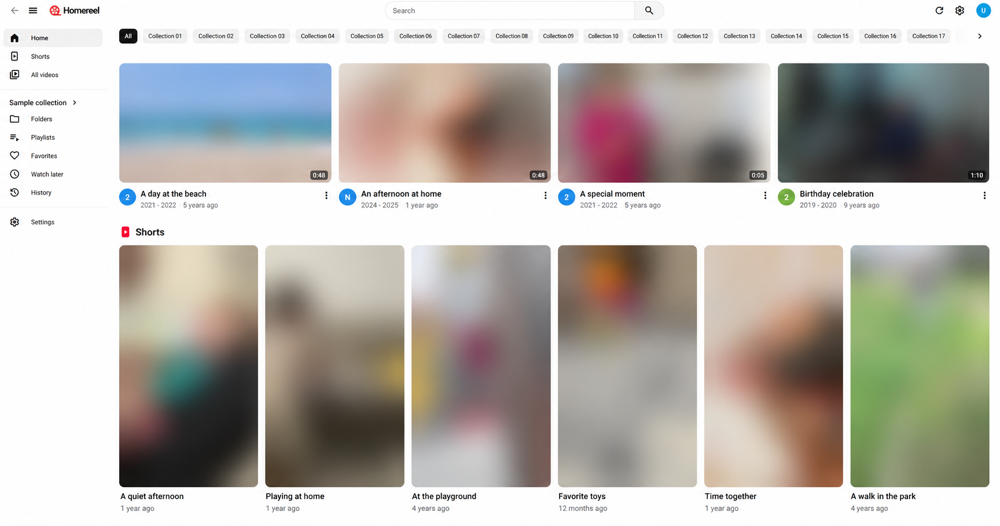
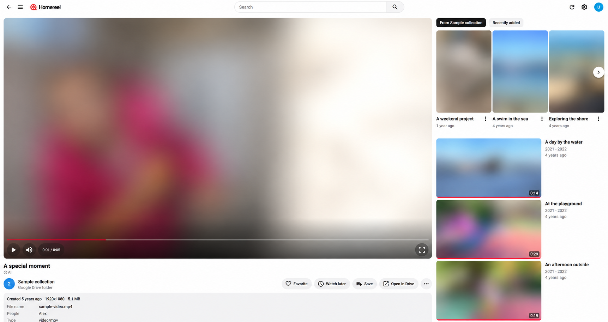
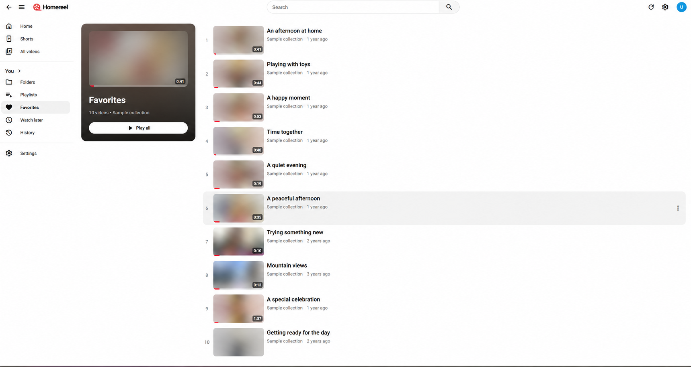
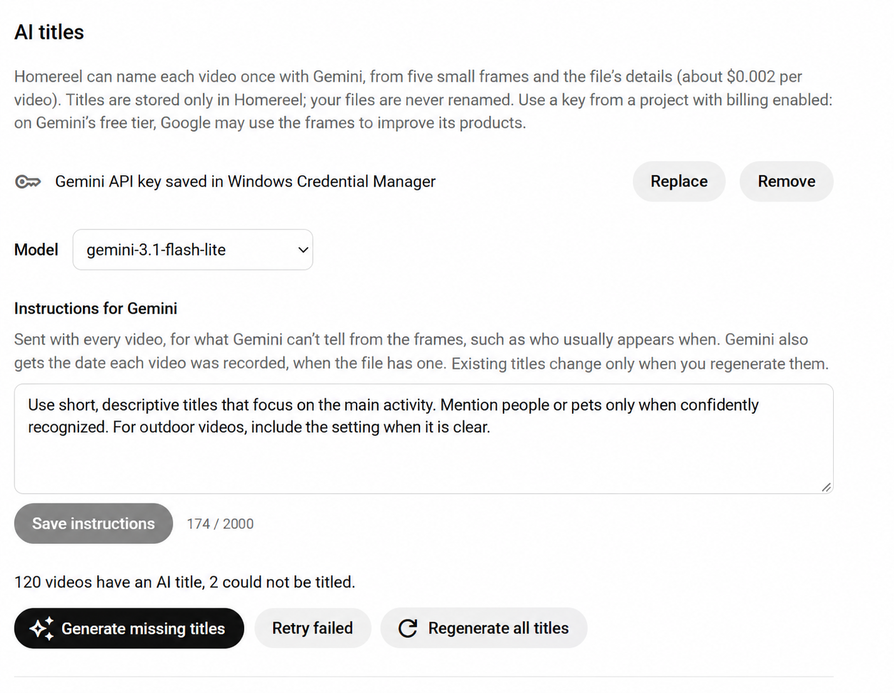
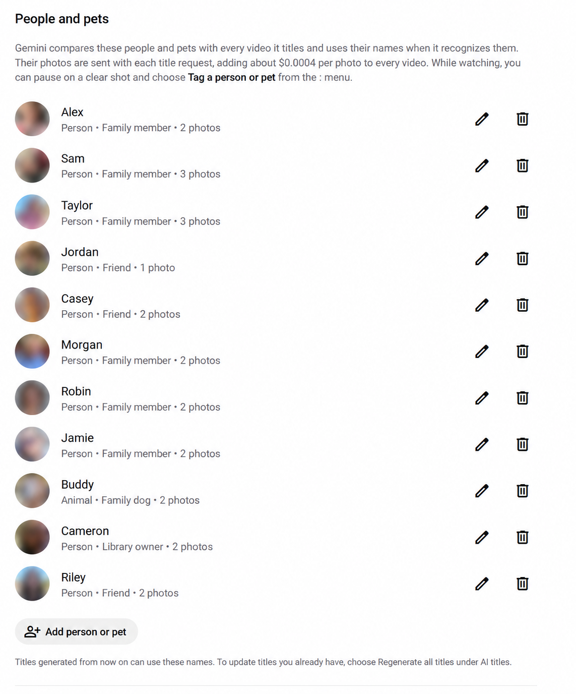

# Homereel

A desktop app for Windows and macOS (Apple Silicon) that shows your own videos in a
YouTube-style interface: those in Google Drive™ (all of it, or one folder and its subfolders), in
folders on this computer, or both. Choose them in **Settings → Video library**. Files are only read, never changed. Favorites, Watch later,
playlists, history and AI titles are stored on this computer only.

## Features

- One video library for Google Drive and local folders.
- Familiar browsing with thumbnails, folder filters, search and a Shorts feed.
- Favorites, Watch later, playlists and watch history with resume points.
- Optional Gemini titles with custom instructions and people and pet recognition.
- Light, dark and system themes.

## Screenshots

These screenshots use blurred media and generic sample titles, names and descriptions.

**Home and Shorts**



<details>
<summary>Playback, favorites and AI settings</summary>

**Video player**



**Favorites**



**AI titles**



**People and pets**



</details>

## Install

The install script builds Homereel from source and installs it. It checks the toolchain and
offers to install what is missing (with winget on Windows, Homebrew and rustup on macOS). Then it
asks for your Google OAuth client JSON: create the client first as described in
[docs/setup.md](docs/setup.md), or press Enter to build without Google Drive. Videos in folders on
the computer play either way.

**Windows**, in PowerShell:

```powershell
irm https://raw.githubusercontent.com/spapafot/homereel/main/scripts/install.ps1 | iex
```

**macOS (Apple Silicon)**, in Terminal:

```bash
curl -fsSL https://raw.githubusercontent.com/spapafot/homereel/main/scripts/install.sh | bash
```

The script clones the source to `homereel` in your home folder (set `HOMEREEL_DIR` to change it)
and keeps the OAuth client there. Run the same command again to update. The first build takes
several minutes. On Windows, installing the Visual Studio Build Tools takes longer and asks for
administrator approval.

In a clone of this repository, `powershell -ExecutionPolicy Bypass -File scripts/install.ps1` or
`bash scripts/install.sh` builds and installs that clone as it is, without pulling.

The rest of this README covers building by hand and development.

## First-time setup

1. Install the toolchain (Node, Rust, and Visual Studio Build Tools on Windows or the Xcode
   Command Line Tools on macOS) and fetch ffmpeg. See
   [docs/setup.md → Toolchain](docs/setup.md#toolchain).
2. Put your Google OAuth client in `src-tauri/google-oauth-client.json`. See
   [docs/setup.md](docs/setup.md). Builds without it cannot connect to Drive, but still play
   videos from folders on the computer.
3. Install the packages:

   ```bash
   npm install
   ```

## Run while developing

```bash
npm run dev
```

This opens the app with hot reload. Changes to the React code show up immediately; changes to
the Rust code rebuild and restart the window. Development builds also import `GEMINI_API_KEY`
from `.env` (see [docs/setup.md](docs/setup.md#gemini-api-key-ai-titles)).

## Build a new version to install

1. Close Homereel and stop `npm run dev`. Only one Homereel window can run at a time.
2. Optional: raise `version` in `src-tauri/tauri.conf.json` (for example `0.1.0` → `0.2.0`) so
   you can tell builds apart. The installer then upgrades the old version.
3. Check and build:

   ```bash
   npm run typecheck
   npm run lint
   npm test
   npm run build
   ```

   The build takes a few minutes. It builds for the computer it runs on:
   - **Windows**: the installer
     `src-tauri/target/release/bundle/nsis/Homereel_<version>_x64-setup.exe` and the bare app
     `src-tauri/target/release/homereel.exe` (with `ffmpeg.exe` next to it).
   - **macOS**: the disk image
     `src-tauri/target/release/bundle/dmg/Homereel_<version>_aarch64.dmg` and the app
     `src-tauri/target/release/bundle/macos/Homereel.app`. It runs on Apple Silicon Macs with
     macOS 12 or later.

4. Install it:
   - **Windows**: run the setup file. It installs for your Windows user. Start **Homereel**
     from the Start menu.
   - **macOS**: open the `.dmg` and drag **Homereel** to **Applications**. The app is signed ad
     hoc, without an Apple developer account. It opens normally on the Mac that built it. On
     another Mac, macOS blocks the first launch: open **System Settings → Privacy & Security**
     and click **Open Anyway**.

| What                                  | Windows                                                               | macOS                                                                 |
| ------------------------------------- | --------------------------------------------------------------------- | --------------------------------------------------------------------- |
| Favorites, playlists, history, titles | `%APPDATA%\com.homereel.desktop\homereel.sqlite3`                     | `~/Library/Application Support/com.homereel.desktop/homereel.sqlite3` |
| Thumbnail cache                       | `%LOCALAPPDATA%\com.homereel.desktop\`                                | `~/Library/Caches/com.homereel.desktop/`                              |
| Logs                                  | `%LOCALAPPDATA%\com.homereel.desktop\logs\`                           | `~/Library/Logs/com.homereel.desktop/`                                |
| Google sign-in, Gemini key            | Windows Credential Manager, entries ending in `.com.homereel.desktop` | Keychain Access, login keychain, entries named `com.homereel.desktop` |

To back up your library, copy the `.sqlite3` file while Homereel is closed.

## Commands

| Command             | What it does                              |
| ------------------- | ----------------------------------------- |
| `npm run dev`       | Run the app in development mode           |
| `npm run build`     | Build the release app and installer       |
| `npm test`          | Frontend tests (Vitest) and Rust tests    |
| `npm run typecheck` | TypeScript check                          |
| `npm run lint`      | oxlint and `cargo clippy` (warnings fail) |
| `npm run format`    | Prettier and `cargo fmt`                  |

## Troubleshooting

- **`failed to run 'cargo metadata' … program not found`**: the terminal was opened before Rust
  was installed. Open a new terminal, or restart VS Code.
- **Nothing happens when starting Homereel**: another copy is already running, often
  `npm run dev`. It gets focus instead. Close it first.
- **The build fails because `binaries/ffmpeg-x86_64-pc-windows-msvc.exe` (or
  `binaries/ffmpeg-aarch64-apple-darwin` on macOS) doesn't exist**, or in development frame
  thumbnails and AI titles fail: ffmpeg is missing. On Windows, run
  `powershell -ExecutionPolicy Bypass -File scripts/fetch-ffmpeg.ps1`. On macOS, run
  `bash scripts/fetch-ffmpeg.sh`. Then build again.
- **macOS asks whether Homereel may use the keychain**: this happens after each new build,
  because the ad-hoc signature changes. Enter your password and click **Always Allow**.
- **The macOS build stops at `bundle_dmg.sh` with `Finder got an error: AppleEvent timed out`**:
  the terminal may not control Finder, which arranges the disk image window. Allow it under
  **System Settings → Privacy & Security → Automation**, or run `CI=true npm run build` to skip
  the window layout. `Homereel.app` is already built at that point.
- **Google asks you to sign in again every week**: the OAuth app is still in _Testing_. See
  [docs/setup.md](docs/setup.md).

## License

Homereel is released under the [MIT License](LICENSE).

It uses this third-party software under its own licenses:

| Software                                                                                 | License    | Notes                                                                                                               |
| ---------------------------------------------------------------------------------------- | ---------- | ------------------------------------------------------------------------------------------------------------------- |
| [ffmpeg](https://ffmpeg.org) (gyan.dev build on Windows, martin-riedl.de build on macOS) | GPL v3     | Not in this repository: `scripts/fetch-ffmpeg.ps1` and `scripts/fetch-ffmpeg.sh` download it; installers include it |
| [Roboto](https://fonts.google.com/specimen/Roboto)                                       | OFL 1.1    | Through `@fontsource/roboto`                                                                                        |
| [Material Symbols](https://fonts.google.com/icons)                                       | Apache 2.0 | Through `material-symbols`                                                                                          |

Homereel runs ffmpeg as its own process and does not link to it. If you share installers you
built, include ffmpeg's license and say where its source is: the exact version is in
`src-tauri/binaries/FFMPEG_VERSION.txt` (Windows) and
`src-tauri/binaries/FFMPEG_VERSION.macos.txt` (macOS).

## Trademarks

Homereel is an independent project. It is not affiliated with, endorsed by or sponsored by
Google or YouTube. Google Drive and YouTube are trademarks of Google LLC.
